# 课程绘本书架

在25节绘本讲读课之外，复核了全部41节的本地语音转写，并对候选书名所在的关键视频画面进行核验。单本清单收录口述点名、主动展示封面或连续朗读/内页可匹配的作品；系列、未确认的版本与非绘本读物另列。并非把背景书架上所有书脊均当成课程提及。

共 44 项已核实书目（单本和系列分别标注）。

[打开绘本网页](books.html)

## My Friend is Sad

- 类型：单本
- 作者：Mo Willems
- ISBN：9781423102977
- 出版信息：[来源](https://books.disney.com/book/my-friend-is-sad/)

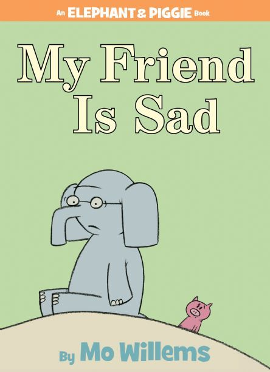
- 提及位置：[16_My_Friend_Is_Sad](index.html#lesson=v_675db494e4b023c058b6ca9e)

## Today I Will Fly!

- 类型：单本
- 作者：Mo Willems
- ISBN：9781423102953
- 出版信息：[来源](https://books.disney.com/book/today-i-will-fly/)

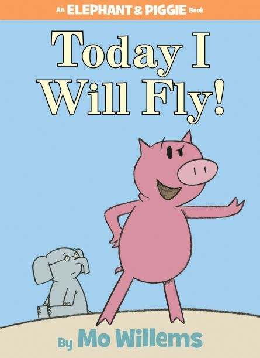
- 提及位置：[17_Today_I_Will_Fly](index.html#lesson=v_675fb7fce4b0694c9514aede)

## There Is a Bird On Your Head!

- 类型：单本
- 作者：Mo Willems
- ISBN：9781423106869
- 出版信息：[来源](https://books.disney.com/book/there-is-a-bird-on-your-head/)

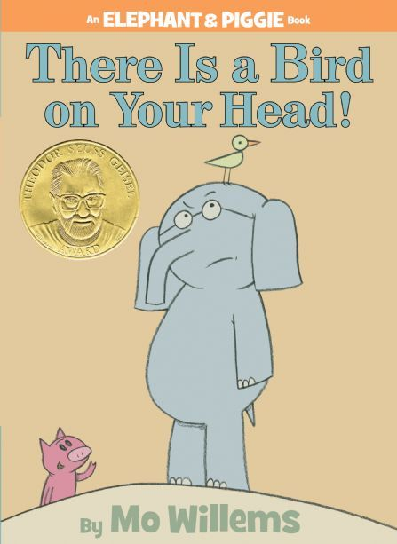
- 提及位置：[18_There_Is_A_Bird_On_Your_Head](index.html#lesson=v_67625167e4b0694c3c7cc19e)

## I Am Invited to a Party!

- 类型：单本
- 作者：Mo Willems
- ISBN：9781423106876
- 出版信息：[来源](https://books.disney.com/book/i-am-invited-to-a-party/)

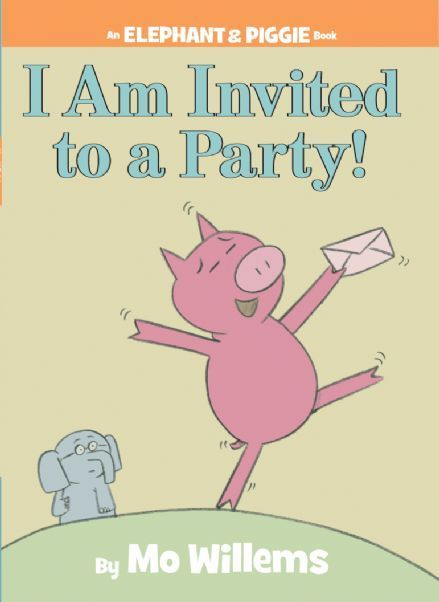
- 提及位置：[19_I_Am_Invited_to_a_Party](index.html#lesson=v_676852c1e4b0694c3c7f29f8)

## I Love My New Toy!

- 类型：单本
- 作者：Mo Willems
- ISBN：9781423109617
- 出版信息：[来源](https://books.disney.com/book/i-love-my-new-toy/)

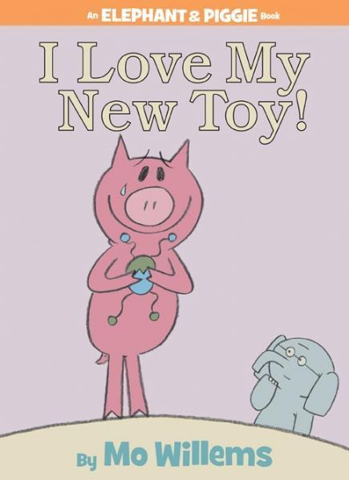
- 提及位置：[20_I_Love_MY_New_Toy](index.html#lesson=v_6768cc61e4b023c058bb970e)

## I Will Surprise My Friend!

- 类型：单本
- 作者：Mo Willems
- ISBN：9781423109624
- 出版信息：[来源](https://books.disney.com/book/i-will-surprise-my-friend/)

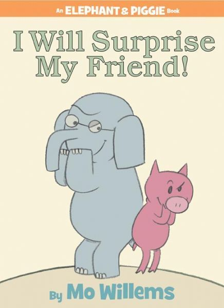
- 提及位置：[21_I_Will_Surprise_My_Friend](index.html#lesson=v_6769b463e4b023c058bc3911)

## Are You Ready to Play Outside?

- 类型：单本
- 作者：Mo Willems
- ISBN：9781423113478
- 出版信息：[来源](https://books.disney.com/book/are-you-ready-to-play-outside/)

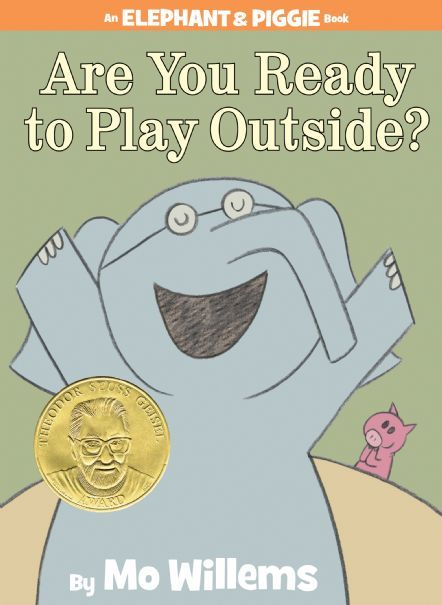
- 提及位置：[22_Are_You_Ready_to_Plasy_Outside](index.html#lesson=v_676b8bfbe4b0694c951ade5c)

## Watch Me Throw the Ball!

- 类型：单本
- 作者：Mo Willems
- ISBN：9781423113485
- 出版信息：[来源](https://books.disney.com/book/watch-me-throw-the-ball/)

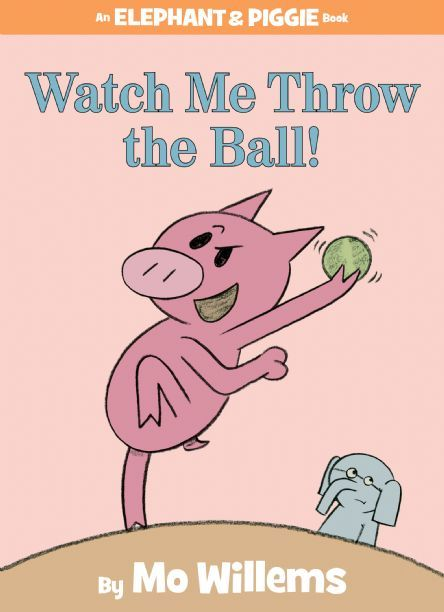
- 提及位置：[23_Watch_Me_Throw_the_Ball](index.html#lesson=v_6774b989e4b0694c951f3120)

## Elephants Cannot Dance!

- 类型：单本
- 作者：Mo Willems
- ISBN：9781423114109
- 出版信息：[来源](https://books.disney.com/book/elephants-cannot-dance/)

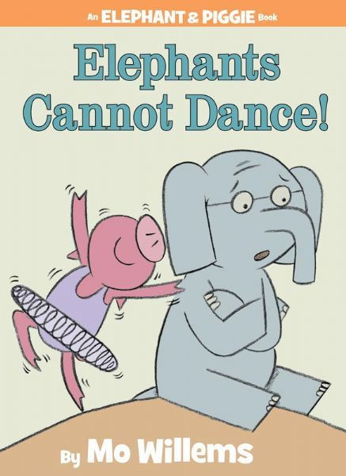
- 提及位置：[24_Elephant_Cannot_Dance](index.html#lesson=v_6776a946e4b0694c3c855096)

## Pigs Make Me Sneeze!

- 类型：单本
- 作者：Mo Willems
- ISBN：9781423114116
- 出版信息：[来源](https://books.disney.com/book/pigs-make-me-sneeze/)

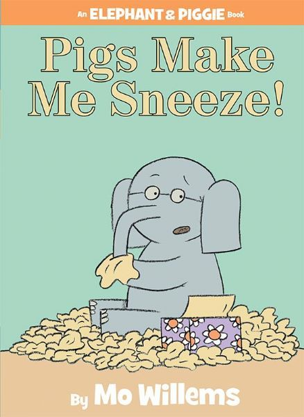
- 提及位置：[25_Pigs_Make_Me_Sneeze](index.html#lesson=v_67773751e4b023c058c21266)

## I Am Going!

- 类型：单本
- 作者：Mo Willems
- ISBN：9781423119906
- 出版信息：[来源](https://books.disney.com/book/i-am-going/)

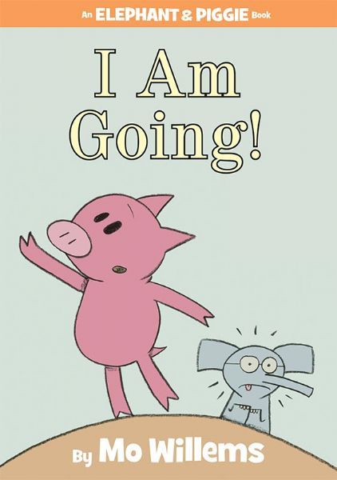
- 提及位置：[26_I_Am_Going](index.html#lesson=v_6779a952e4b0694c3c8670e0)

## Can I Play Too?

- 类型：单本
- 作者：Mo Willems
- ISBN：9781423119913
- 出版信息：[来源](https://books.disney.com/book/can-i-play-too/)

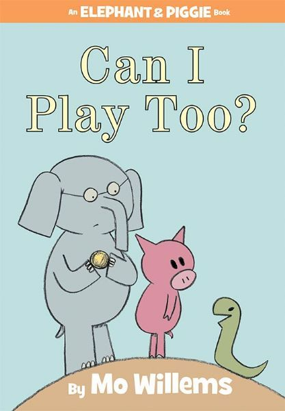
- 提及位置：[27_Can_I_Play_Too](index.html#lesson=v_6780971de4b092c1697eff29)

## We Are in a Book!

- 类型：单本
- 作者：Mo Willems
- ISBN：9781423133087
- 出版信息：[来源](https://books.disney.com/book/we-are-in-a-book/)

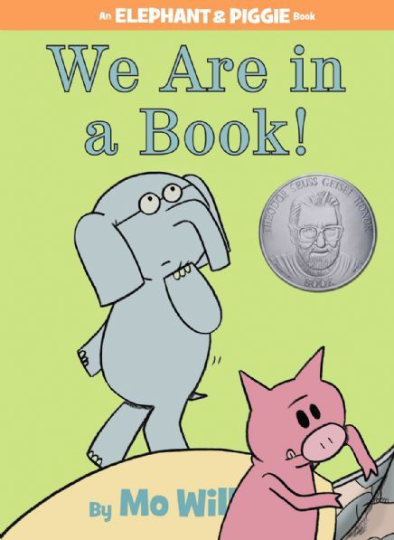
- 提及位置：[28_We_Are_in_a_Book](index.html#lesson=v_678b215ae4b0694c5a83e8e0)

## I Broke My Trunk!

- 类型：单本
- 作者：Mo Willems
- ISBN：9781423133094
- 出版信息：[来源](https://books.disney.com/book/i-broke-my-trunk/)

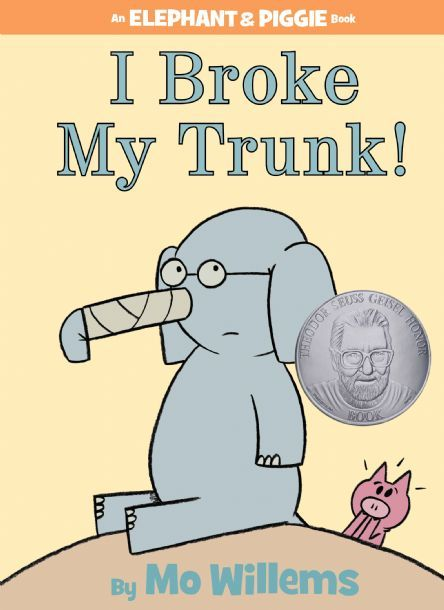
- 提及位置：[29_I_Broke_My_Trunk](index.html#lesson=v_678c02d9e4b0694ca04cd796)

## Should I Share My Ice Cream?

- 类型：单本
- 作者：Mo Willems
- ISBN：9781423143437
- 出版信息：[来源](https://books.disney.com/book/should-i-share-my-ice-cream/)

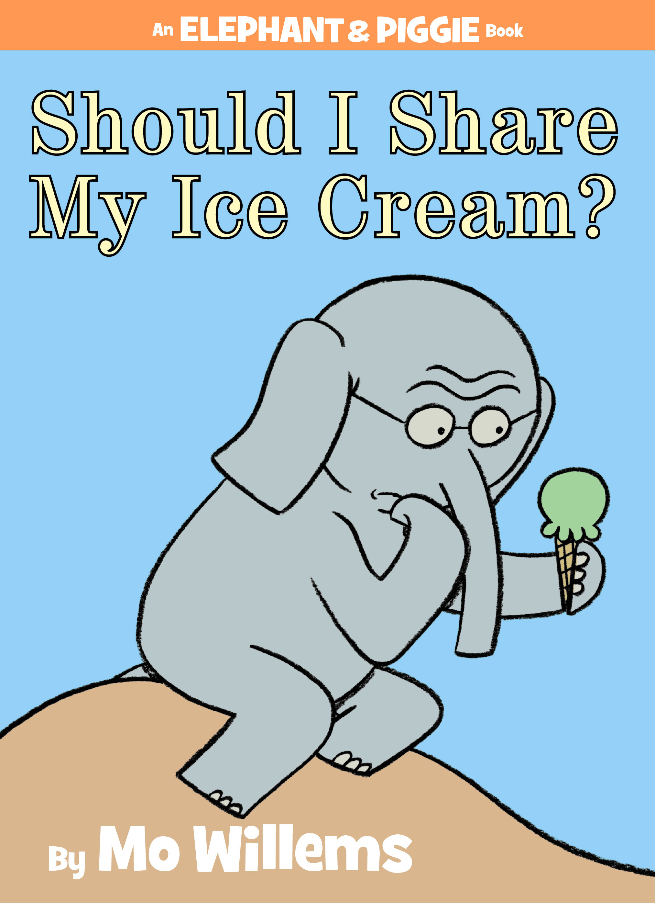
- 提及位置：[30_Should_I_Share_My_Ice_Cream](index.html#lesson=v_678f13cbe4b0694ca04ee5af)

## Happy Pig Day!

- 类型：单本
- 作者：Mo Willems
- ISBN：9781423143420
- 出版信息：[来源](https://books.disney.com/book/happy-pig-day/)

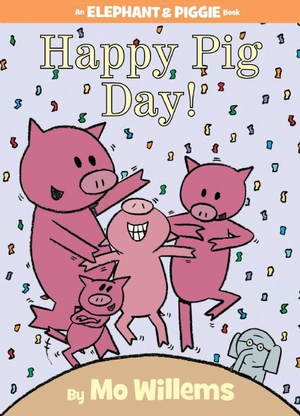
- 提及位置：[31_Happy_Pig_Day](index.html#lesson=v_678f193fe4b0694c5a85ee8c)

## Listen to My Trumpet!

- 类型：单本
- 作者：Mo Willems
- ISBN：9781423154044
- 出版信息：[来源](https://books.disney.com/book/listen-to-my-trumpet/)

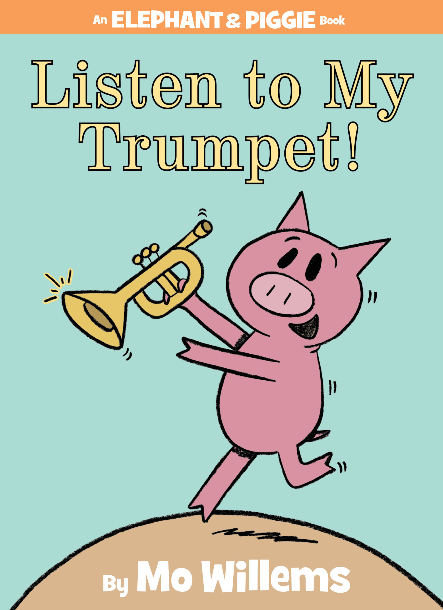
- 提及位置：[32_Listen_to_My_Trumpet](index.html#lesson=v_679af486e4b0694c5a89a0d1)

## Let’s Go for a Drive!

- 类型：单本
- 作者：Mo Willems
- ISBN：9781423164821
- 出版信息：[来源](https://books.disney.com/book/lets-go-for-a-drive/)

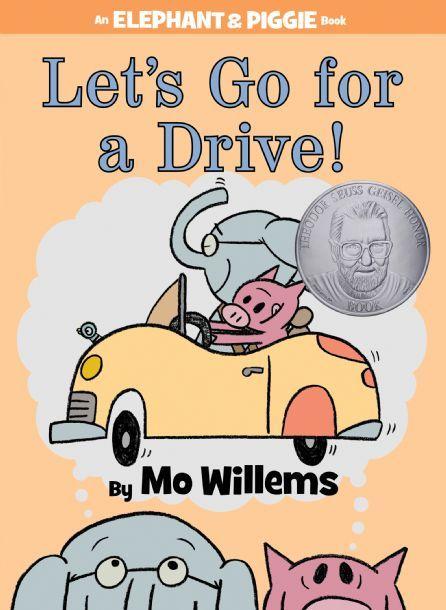
- 提及位置：[33_Let's_Go_for_a_Drive](index.html#lesson=v_679afd8ce4b0694ca053b9be)

## A Big Guy Took My Ball!

- 类型：单本
- 作者：Mo Willems
- ISBN：9781423174912
- 出版信息：[来源](https://books.disney.com/book/a-big-guy-took-my-ball/)

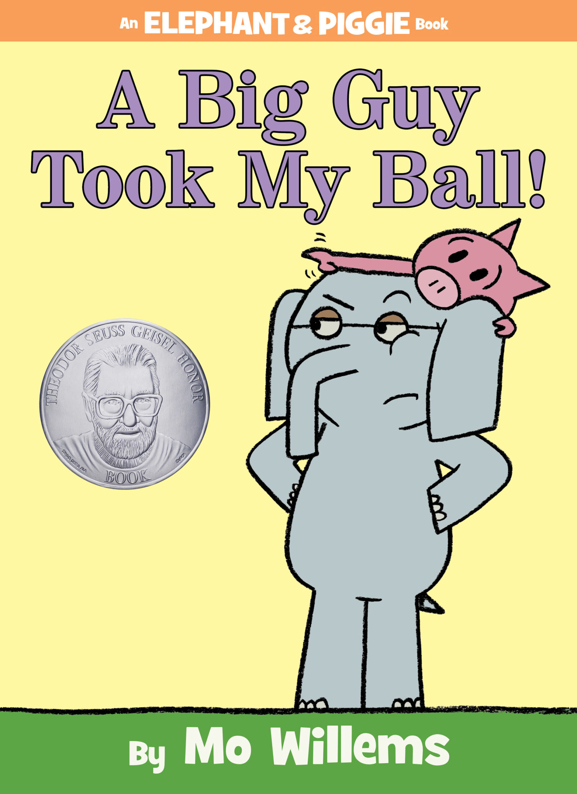
- 提及位置：[34_A_Big_Guy_Took_My_Ball](index.html#lesson=v_679fa192e4b0694c5a8a40bd)

## I’m a Frog!

- 类型：单本
- 作者：Mo Willems
- ISBN：9781423183051
- 出版信息：[来源](https://books.disney.com/book/im-a-frog/)

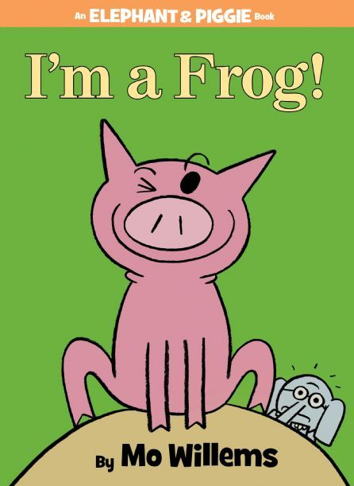
- 提及位置：[35_I'm_a_Frog](index.html#lesson=v_679fa82be4b0694ca0549633)

## My New Friend Is So Fun!

- 类型：单本
- 作者：Mo Willems
- ISBN：9781423179580
- 出版信息：[来源](https://books.disney.com/book/my-new-friend-is-so-fun/)

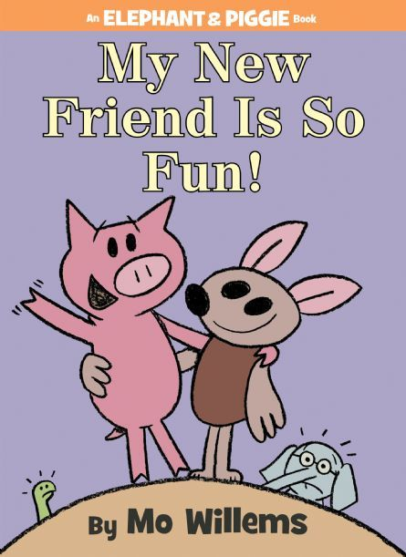
- 提及位置：[36_My_New_Friend_Is_So_Fun](index.html#lesson=v_679fc5dbe4b0694ca05497f9)

## Waiting Is Not Easy!

- 类型：单本
- 作者：Mo Willems
- ISBN：9781423199571
- 出版信息：[来源](https://books.disney.com/book/waiting-is-not-easy/)

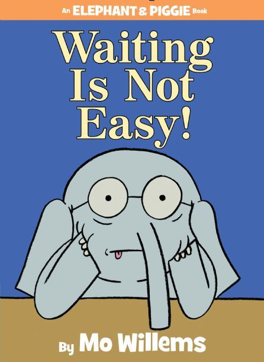
- 提及位置：[37_Waiting_Is_Not_Easy](index.html#lesson=v_67a12eb2e4b0694ca054f496)

## I Will Take A Nap!

- 类型：单本
- 作者：Mo Willems
- ISBN：9781484716304
- 出版信息：[来源](https://books.disney.com/book/i-will-take-a-nap/)

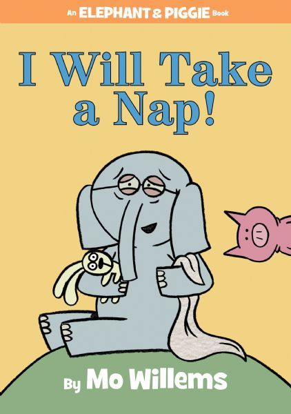
- 提及位置：[38_I_Will_Take_a_Nap](index.html#lesson=v_67a13a19e4b0694ca054f50c)

## I Really Like Slop!

- 类型：单本
- 作者：Mo Willems
- ISBN：9781484722626
- 出版信息：[来源](https://books.disney.com/book/i-really-like-slop/)

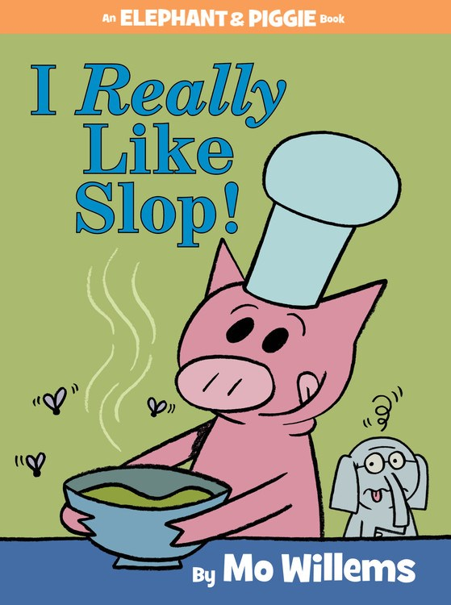
- 提及位置：[39_I_Really_Like_Slop](index.html#lesson=v_67a148a1e4b0694c5a8a875b)

## The Thank You Book

- 类型：单本
- 作者：Mo Willems
- ISBN：9781423178286
- 出版信息：[来源](https://books.disney.com/book/the-thank-you-book/)

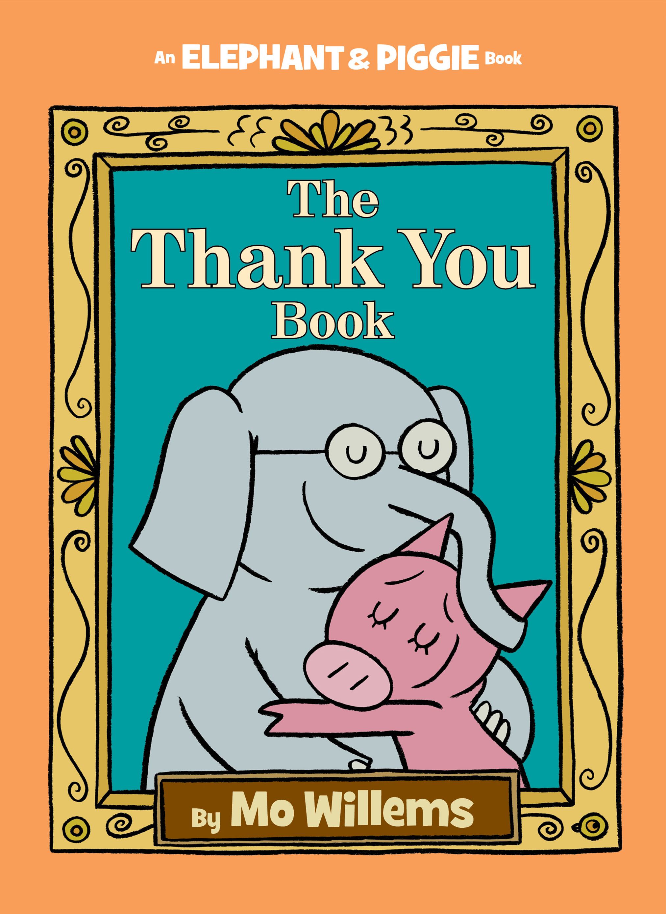
- 提及位置：[40_The_Thank_You_Book](index.html#lesson=v_67a17a4fe4b0694ca05500a6)

## A Walk in the Park

- 类型：单本
- 作者：Anthony Browne
- 出版信息：[来源](https://www.anthonybrownebooks.com/books)

封面来自下列官方书目。课程实物的印次/ISBN未必与封面来源版本相同。

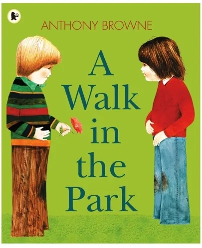
- 提及位置：[12_许瞧的闺房 · 2:28](index.html#lesson=v_67568bf8e4b023c058b2f644&t=148)
  讲师主动展示；画面与作者官网作品封面对照。

## Changes

- 类型：单本
- 作者：Anthony Browne
- 出版信息：[来源](https://www.anthonybrownebooks.com/books)

封面来自下列官方书目。课程实物的印次/ISBN未必与封面来源版本相同。

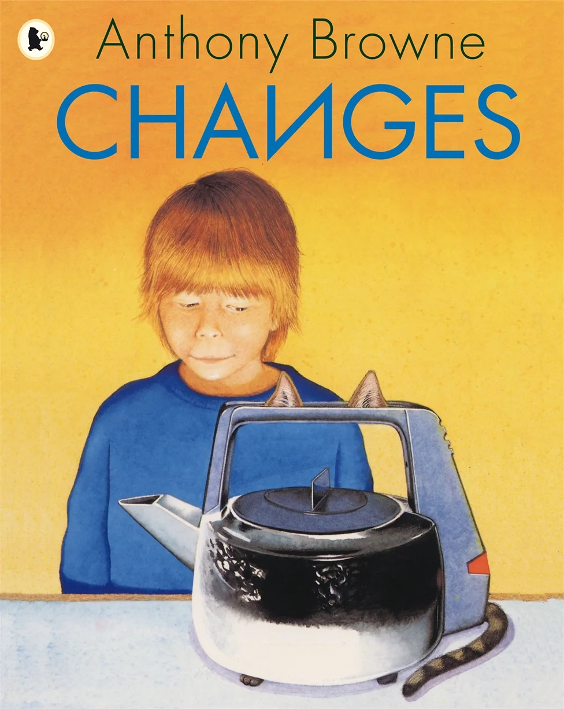
- 提及位置：[12_许瞧的闺房 · 2:30](index.html#lesson=v_67568bf8e4b023c058b2f644&t=150)
  讲师主动展示；画面与作者官网作品封面对照。

## Willy’s Pictures

- 类型：单本
- 作者：Anthony Browne
- 出版信息：[来源](https://www.anthonybrownebooks.com/books)

封面来自下列官方书目。课程实物的印次/ISBN未必与封面来源版本相同。

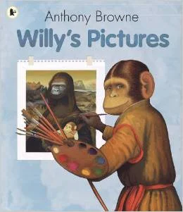
- 提及位置：[12_许瞧的闺房 · 2:32](index.html#lesson=v_67568bf8e4b023c058b2f644&t=152)
  讲师主动展示；画面与作者官网作品封面对照。

## My Mum

- 类型：单本
- 作者：Anthony Browne
- 出版信息：[来源](https://www.anthonybrownebooks.com/books)

封面来自下列官方书目。课程实物的印次/ISBN未必与封面来源版本相同。

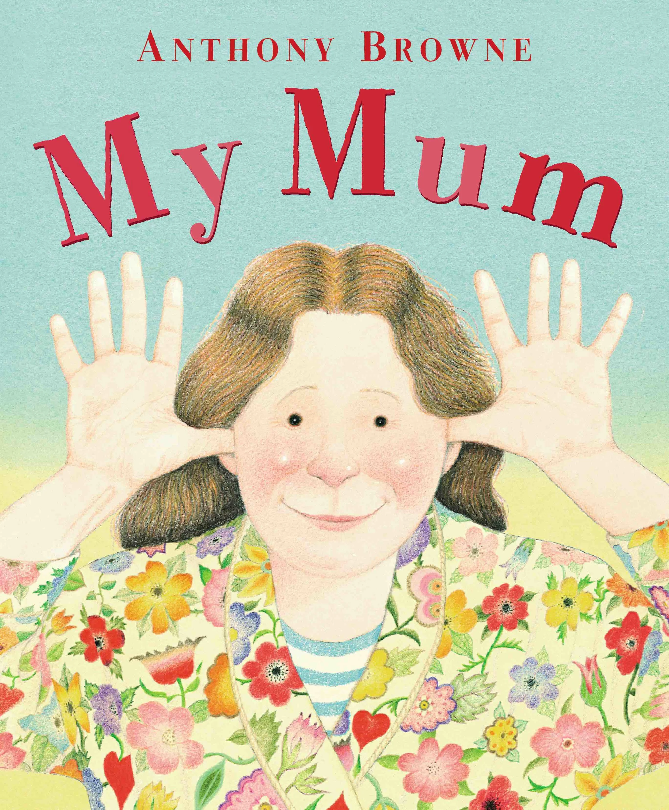
- 提及位置：[12_许瞧的闺房 · 2:44](index.html#lesson=v_67568bf8e4b023c058b2f644&t=164)
  讲师主动展示；画面与作者官网作品封面对照。

## My Brother

- 类型：单本
- 作者：Anthony Browne
- 出版信息：[来源](https://www.anthonybrownebooks.com/books)

封面来自下列官方书目。课程实物的印次/ISBN未必与封面来源版本相同。

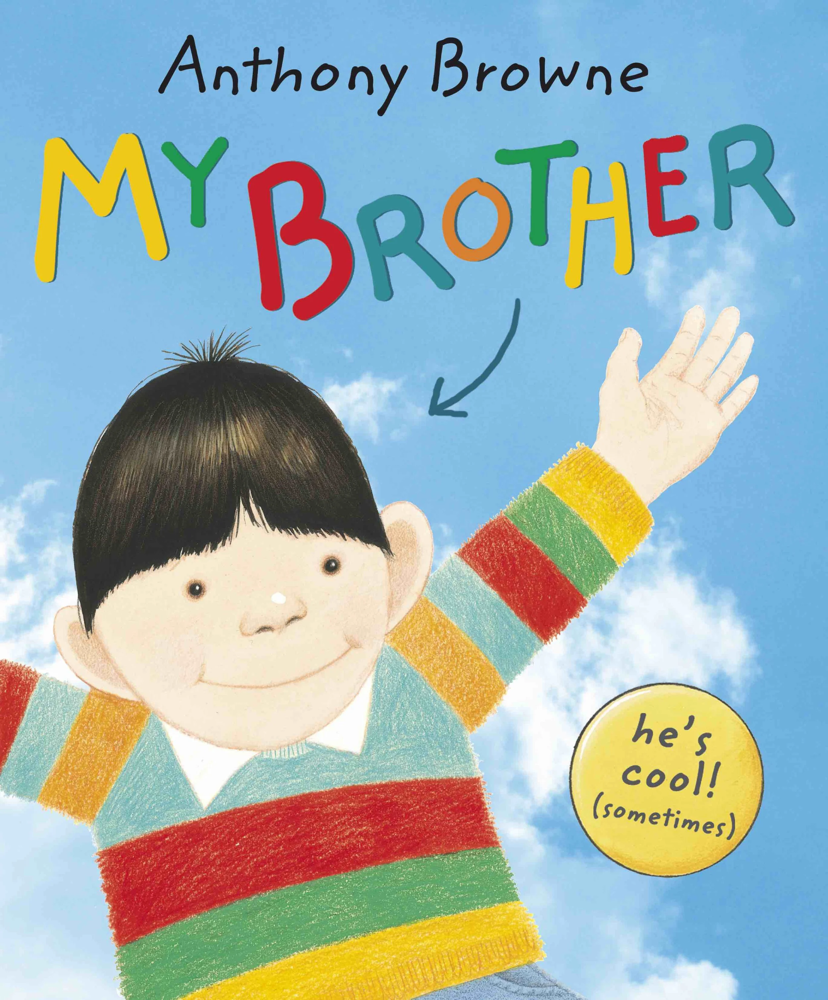
- 提及位置：[12_许瞧的闺房 · 2:52](index.html#lesson=v_67568bf8e4b023c058b2f644&t=172)
  讲师主动展示；画面与作者官网作品封面对照。

## Zoo

- 类型：单本
- 作者：Anthony Browne
- 出版信息：[来源](https://www.anthonybrownebooks.com/books)

封面来自下列官方书目。课程实物的印次/ISBN未必与封面来源版本相同。

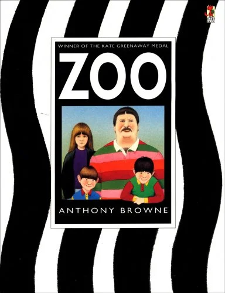
- 提及位置：[12_许瞧的闺房 · 2:24](index.html#lesson=v_67568bf8e4b023c058b2f644&t=144)
  讲师主动展示；画面与作者官网作品封面对照。

## Little Beauty

- 类型：单本
- 作者：Anthony Browne
- 出版信息：[来源](https://www.anthonybrownebooks.com/books)

封面来自下列官方书目。课程实物的印次/ISBN未必与封面来源版本相同。

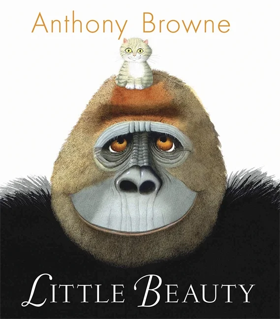
- 提及位置：[12_许瞧的闺房 · 2:26](index.html#lesson=v_67568bf8e4b023c058b2f644&t=146)
  讲师主动展示；画面与作者官网作品封面对照。

## My Dad

- 类型：单本
- 作者：Anthony Browne
- 出版信息：[来源](https://www.anthonybrownebooks.com/books)

封面来自下列官方书目。课程实物的印次/ISBN未必与封面来源版本相同。

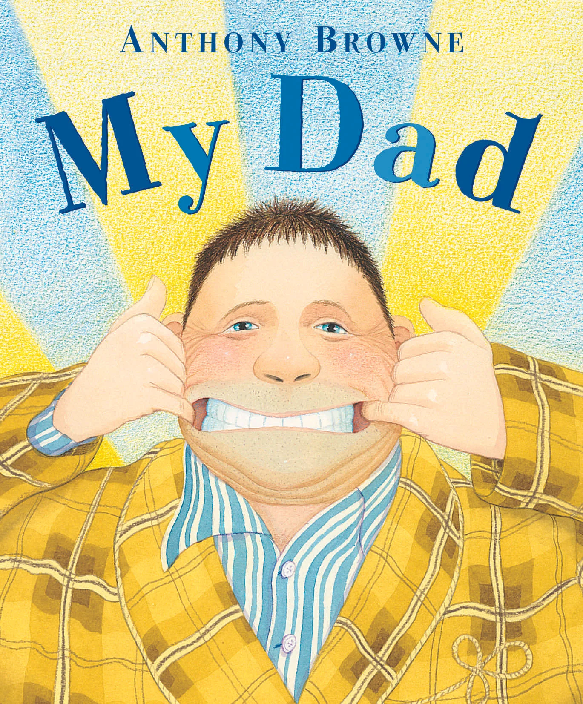
- 提及位置：[12_许瞧的闺房 · 2:40](index.html#lesson=v_67568bf8e4b023c058b2f644&t=160)
  讲师主动展示；画面与作者官网作品封面对照。

## Put Me in the Zoo

- 类型：单本
- 作者：Robert Lopshire
- ISBN：9780394800172
- 出版信息：[来源](https://www.penguinrandomhouse.com/books/103589/put-me-in-the-zoo-by-robert-lopshire/)

封面来自下列官方书目。课程实物的印次/ISBN未必与封面来源版本相同。

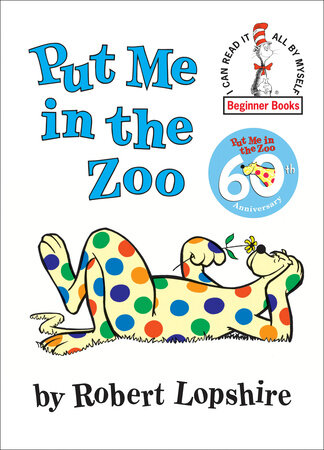
- 提及位置：[07_说（唱） · 1:50](index.html#lesson=v_674dd73ae4b0694c3c72dfdd&t=110)
  阅读片段
- 提及位置：[08_读 · 4:49](index.html#lesson=v_674f0836e4b0694c950c710b&t=289)
  斑点动物内页与朗读内容对应

## A Fly Went By

- 类型：单本
- 作者：Mike McClintock
- ISBN：9780394800035
- 出版信息：[来源](https://www.penguinrandomhouse.com/books/110655/a-fly-went-by-by-mike-mcclintock/)

连续独特朗读文本与该作品匹配；视频此段为车内背诵，没有显示封面。课程版本/ISBN未确认，封面展示查得的出版版本。

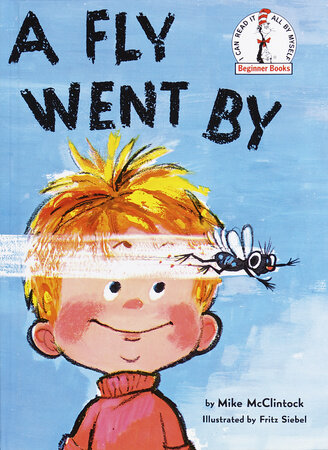
- 提及位置：[07_说（唱） · 2:24](index.html#lesson=v_674dd73ae4b0694c3c72dfdd&t=144)
  动物追逐故事阅读片段

## The Big Purple Book of Beginner Books

- 类型：单本
- 作者：P. D. Eastman; Peter Eastman; Helen Palmer; Michael Frith
- ISBN：9780307975874
- 出版信息：[来源](https://www.penguinrandomhouse.com/books/217813/the-big-purple-book-of-beginner-books-by-pd-eastman/9780307975874/)

封面来自下列官方书目。课程实物的印次/ISBN未必与封面来源版本相同。

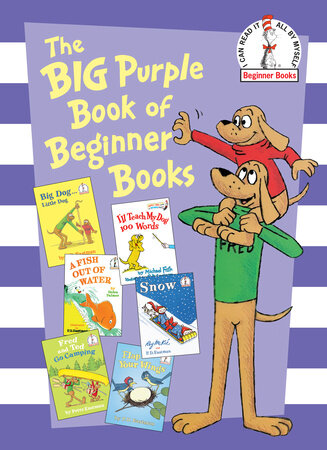
- 提及位置：[12_许瞧的闺房 · 8:31](index.html#lesson=v_67568bf8e4b023c058b2f644&t=511)
  紫色合订本封面可见；不把目录中的各篇自动视作分别提及

## The Very Hungry Caterpillar

- 类型：单本
- 作者：Eric Carle
- ISBN：9780399208539
- 出版信息：[来源](https://www.penguinrandomhouse.com/books/301943/the-very-hungry-caterpillar-by-eric-carle/)

封面来自下列官方书目。课程实物的印次/ISBN未必与封面来源版本相同。

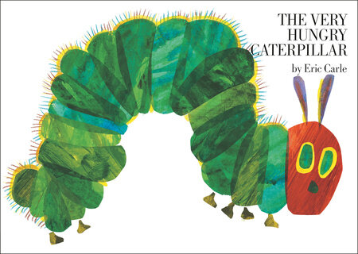
- 提及位置：[12_许瞧的闺房 · 14:29](index.html#lesson=v_67568bf8e4b023c058b2f644&t=869)
  讲师口述 Hungry Caterpillar；以作者出版社规范全名

## Spot Goes to School

- 类型：单本
- 作者：Eric Hill
- ISBN：9780141343785
- 出版信息：[来源](https://www.penguin.co.uk/books/37645/spot-goes-to-school-by-eric-hill/9780141343785)

封面来自下列官方书目。课程实物的印次/ISBN未必与封面来源版本相同。

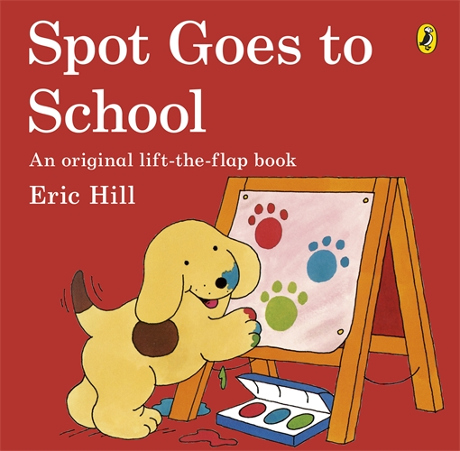
- 提及位置：[12_许瞧的闺房 · 1:46](index.html#lesson=v_67568bf8e4b023c058b2f644&t=106)
- 提及位置：[13_绘本的使用 · 10:13](index.html#lesson=v_6757658ce4b0694c3c7757f0&t=613)
- 提及位置：[04_对父母的挑战 · 8:18](index.html#lesson=v_674d2e2ee4b0694c3c7251f3&t=498)

## Spot Goes to the Farm

- 类型：单本
- 作者：Eric Hill
- ISBN：9780141340845
- 出版信息：[来源](https://www.penguin.co.uk/books/37911/spot-goes-to-the-farm-by-eric-hill/9780141340845)

封面来自下列官方书目。课程实物的印次/ISBN未必与封面来源版本相同。

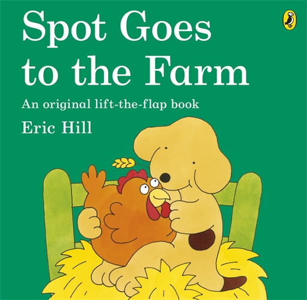
- 提及位置：[03_兴趣 · 7:39](index.html#lesson=v_674d2cb1e4b023c058aecfdd&t=459)
  封面部分字样、人物图案及朗读内页综合核验

## Spot Stays Overnight

- 类型：单本
- 作者：Eric Hill
- ISBN：9780241712351
- 出版信息：[来源](https://www.penguin.co.uk/books/122787/spot-stays-overnight-by-hill-eric/9780241712351)

课程为紫色封面旧版；此处为出版社现行2025纸板版封面，同一作品，非声称课程相同印次。

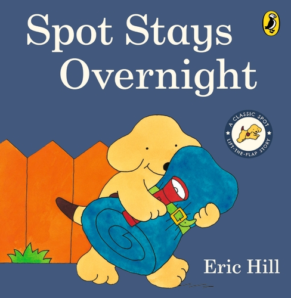
- 提及位置：[04_对父母的挑战 · 7:46](index.html#lesson=v_674d2e2ee4b0694c3c7251f3&t=466)
  474秒紫色正封书名可读

## Spot Goes on Holiday

- 类型：单本
- 作者：Eric Hill
- ISBN：9780141343778
- 出版信息：[来源](https://www.penguin.co.uk/books/37693/spot-goes-on-holiday-by-eric-hill/9780141343778)

按连续内页、朗读及出版社介绍确认作品；课程未露封面，具体版本/ISBN未确认。这里展示查得的出版版本封面。

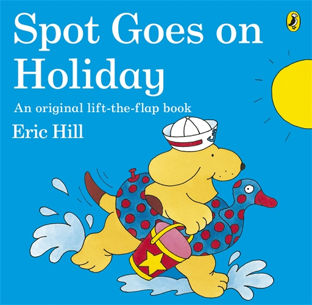
- 提及位置：[13_绘本的使用 · 8:20](index.html#lesson=v_6757658ce4b0694c3c7757f0&t=500)
  连续内页与朗读出现乘船、落水、毛巾、新朋友；和出版社故事介绍匹配。

## Maisy Goes to Bed

- 类型：单本
- 作者：Lucy Cousins
- ISBN：9781406371529
- 出版信息：[来源](https://www.walker.co.uk/9781406371529/maisy-goes-to-bed/)

封面来自下列官方书目。课程实物的印次/ISBN未必与封面来源版本相同。

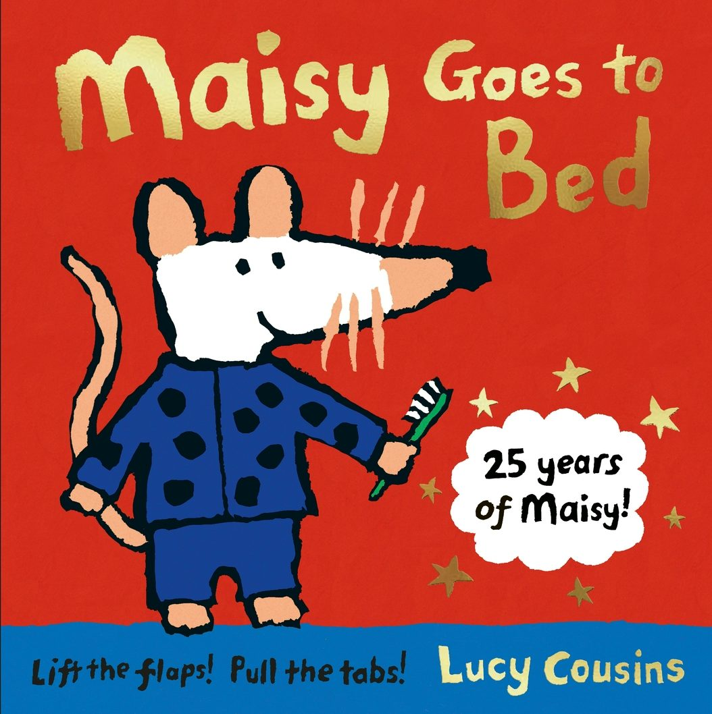
- 提及位置：[12_许瞧的闺房 · 14:56](index.html#lesson=v_67568bf8e4b023c058b2f644&t=896)
  正封可读标题、Lucy Cousins及A pull-the-tab book；随后演示拉拉页。

## Love You Forever

- 类型：单本
- 作者：Robert Munsch
- 出版信息：[来源](https://robertmunsch.com/book/love-you-forever)

封面来自下列官方书目。课程实物的印次/ISBN未必与封面来源版本相同。

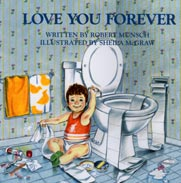
- 提及位置：[12_许瞧的闺房 · 3:09](index.html#lesson=v_67568bf8e4b023c058b2f644&t=189)
  266秒正封书名与作者、绘者可读。

## My Car

- 类型：单本
- 作者：Byron Barton
- ISBN：9780060296247
- 出版信息：[来源](https://www.harpercollins.com/products/my-car-byron-barton)

课程展示黄色封面纸板版；书名作者已确认。封面来自Publishers Weekly所列出版版本，课程实物ISBN未确认。

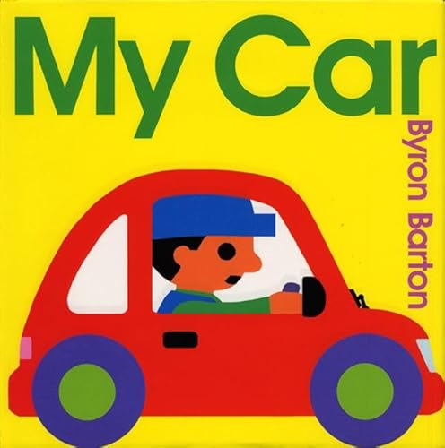
- 提及位置：[08_读 · 11:06](index.html#lesson=v_674f0836e4b0694c950c710b&t=666)
  666秒封面书名与Byron Barton作者可读，随后翻页朗读。

## 课程提及的系列

### Spot

课程多次提到整个Spot系列。已能确定的单册另列；这里借用已确认的Spot Goes to School封面作系列代表，不表示全系列每本都被课程点名。

[书目信息来源](https://www.penguin.co.uk/series/SPODOG/spot)

- 提及位置：[08_读](index.html#lesson=v_674f0836e4b0694c950c710b&t=770)
- 提及位置：[12_许瞧的闺房](index.html#lesson=v_67568bf8e4b023c058b2f644&t=100)
- 提及位置：[22_Are_You_Ready_to_Plasy_Outside](index.html#lesson=v_676b8bfbe4b0694c951ade5c&t=127)

### Oxford Reading Tree

课程介绍分级阅读系列并翻看书册；未把整套各册都算作提及。另有01节的内页候选A Big Mess，版本差异尚未解决。

[书目信息来源](https://home.oxfordowl.co.uk/reading/reading-schemes-oxford-levels/oxford-reading-tree-levels/)

- 提及位置：[11_许闻的书房](index.html#lesson=v_675281f3e4b0694c3c753213&t=40)
- 提及位置：[12_许瞧的闺房](index.html#lesson=v_67568bf8e4b023c058b2f644&t=278)

### The Magic School Bus

课程按系列介绍；未确认讲师指向的具体单册，因此没有随意选一本封面冒充所示版本。

[书目信息来源](https://www.scholastic.com/newsroom/online-press-kits/magic-school-bus.html)

- 提及位置：[11_许闻的书房](index.html#lesson=v_675281f3e4b0694c3c753213&t=31)

### My First Discoveries

透明页儿童科普系列；课程此处未说出所翻单册题名，保留系列层级。

[书目信息来源](https://moonlightpublishing.co.uk/our-catalogue/)

- 提及位置：[11_许闻的书房](index.html#lesson=v_675281f3e4b0694c3c753213&t=816)

## 尚未确定具体版本的提及

### Little Red Riding Hood（小红帽，版本未确认）

故事已确认，但出版版本、改编者和绘者无法确定；不使用任意小红帽封面替代课程实物。

- 提及位置：[08_读](index.html#lesson=v_674f0836e4b0694c950c710b&t=1272)
- 提及位置：[13_绘本的使用](index.html#lesson=v_6757658ce4b0694c3c7757f0&t=324)

### A Big Mess（高置信候选）

官方同名Level 1+教学笔记的新版pan/jam与课程tin/油漆内容存在差异，未取得同版连续图文完全匹配；保留候选，不算入已确认单本数。

[书目信息来源](https://cdn.oxfordowl.co.uk/2016/05/05/09/16/19/469/ort_fp_fic_bigmess_tns.pdf)

- 提及位置：[01_母语](index.html#lesson=v_67475a5de4b023c058ac7309&t=515)

### 字母绘本（书名未确认）

没有封面或题名页，不凭常见字母内容猜出版物名称。

- 提及位置：[07_说（唱）](index.html#lesson=v_674dd73ae4b0694c3c72dfdd&t=237)

### 问答翻翻书（书名未确认）

课程未清楚说出题名；未把外观相似的科普翻翻书当成已确认版本。

- 提及位置：[11_许闻的书房](index.html#lesson=v_675281f3e4b0694c3c753213&t=421)

## 课程其他阅读参考

### Diary of a Wimpy Kid

课程用作写画示例，单列为其他读物；未把系列每册全部加入绘本单本表。

[书目信息来源](https://wimpykid.com/books/)

- 提及位置：[09_写（画）](index.html#lesson=v_674fcfcde4b0694c3c73c697&t=134)
- 提及位置：[11_许闻的书房](index.html#lesson=v_675281f3e4b0694c3c753213&t=177)

### Dog Man

属于其他阅读材料，未计入绘本单本清单。

- 提及位置：[11_许闻的书房](index.html#lesson=v_675281f3e4b0694c3c753213&t=193)

### Captain Underpants

属于其他阅读材料，未计入绘本单本清单。

- 提及位置：[11_许闻的书房](index.html#lesson=v_675281f3e4b0694c3c753213&t=216)

### Goosebumps

属于其他阅读材料，未计入绘本单本清单。

- 提及位置：[11_许闻的书房](index.html#lesson=v_675281f3e4b0694c3c753213&t=129)

### The Notebook of Doom

属于其他阅读材料，未计入绘本单本清单。

- 提及位置：[11_许闻的书房](index.html#lesson=v_675281f3e4b0694c3c753213&t=228)

### Dragon Masters

属于其他阅读材料，未计入绘本单本清单。

- 提及位置：[11_许闻的书房](index.html#lesson=v_675281f3e4b0694c3c753213&t=235)

### The Wonderful Wizard of Oz

课程版本未确认。

- 提及位置：[11_许闻的书房](index.html#lesson=v_675281f3e4b0694c3c753213&t=270)

### Harry Potter

属于其他阅读材料，未计入绘本单本清单。

- 提及位置：[11_许闻的书房](index.html#lesson=v_675281f3e4b0694c3c753213&t=285)

### Unicorn vs. Goblins

口述标题；具体版本未进一步核验。

- 提及位置：[11_许闻的书房](index.html#lesson=v_675281f3e4b0694c3c753213&t=311)

### Magic Tree House

属于其他阅读材料，未计入绘本单本清单。

- 提及位置：[11_许闻的书房](index.html#lesson=v_675281f3e4b0694c3c753213&t=369)

### The Adventures of Tintin

属于其他阅读材料，未计入绘本单本清单。

- 提及位置：[11_许闻的书房](index.html#lesson=v_675281f3e4b0694c3c753213&t=387)

### The Little Prince

课程版本未确认。

- 提及位置：[11_许闻的书房](index.html#lesson=v_675281f3e4b0694c3c753213&t=171)

### Adventure Bible

具体版次未确认。

- 提及位置：[11_许闻的书房](index.html#lesson=v_675281f3e4b0694c3c753213&t=148)

### Minecraft 相关书

未将游戏或每本指南自行扩为绘本。

- 提及位置：[03_兴趣](index.html#lesson=v_674d2cb1e4b023c058aecfdd&t=824)
- 提及位置：[11_许闻的书房](index.html#lesson=v_675281f3e4b0694c3c753213&t=330)

### Charles Dickens / Bob Dylan / Albert Einstein / Bruce Lee 人物传记

提及人物/传记，未据此推定所有完整书名和版本。

- 提及位置：[11_许闻的书房](index.html#lesson=v_675281f3e4b0694c3c753213&t=70)

### DK 百科与主题参考书

包括Ocean、Human Body、Dinosaurs、Science、Space、History、Animal、The Story of Painting、Dinosaur A to Z等展示/口述；单册版次未全面确认。

- 提及位置：[11_许闻的书房](index.html#lesson=v_675281f3e4b0694c3c753213&t=444)

### LEGO Star Wars: The Visual Dictionary

并非故事绘本。

- 提及位置：[11_许闻的书房](index.html#lesson=v_675281f3e4b0694c3c753213&t=453)

### Shakespeare for Kids / Shakespeare改写读物

提到Hamlet、King Lear、Romeo and Juliet，未确认具体出版物。

- 提及位置：[11_许闻的书房](index.html#lesson=v_675281f3e4b0694c3c753213&t=519)

### Pablo诗集（完整题名未确认）

不能依据残缺转写推断完整题名。

- 提及位置：[11_许闻的书房](index.html#lesson=v_675281f3e4b0694c3c753213&t=140)
- 提及位置：[14_大童的英语追赶](index.html#lesson=v_6757b5a9e4b0694c9510abb8&t=538)

### Hamilton相关读物

包括口述A Kid’s Guide to Hamilton the Musical、499 Facts About Hip-Hop Hamilton；歌词/照片书的准确题名未全确认。

- 提及位置：[11_许闻的书房](index.html#lesson=v_675281f3e4b0694c3c753213&t=571)
- 提及位置：[11_许闻的书房](index.html#lesson=v_675281f3e4b0694c3c753213&t=660)

### I Want to Be a Producer

题名口述，非幼儿绘本。

- 提及位置：[11_许闻的书房](index.html#lesson=v_675281f3e4b0694c3c753213&t=647)

### The Lion King剧场相关书

课程版次未确认；没有将电影/歌曲当作绘本。

- 提及位置：[11_许闻的书房](index.html#lesson=v_675281f3e4b0694c3c753213&t=725)

### New Concept English（新概念英语）

讨论传统学习方式时提及，非绘本推荐。

- 提及位置：[00_先导](index.html#lesson=v_673ab182e4b023c058a6547d&t=940)
- 提及位置：[15_成年人（父母）的最后一搏](index.html#lesson=v_6758f107e4b0694c3c782feb&t=99)

### 孩子自创的妈妈/生日绘本

不是可核对出版社封面的商业出版物。

- 提及位置：[09_写（画）](index.html#lesson=v_674fcfcde4b0694c3c73c697&t=253)
- 提及位置：[09_写（画）](index.html#lesson=v_674fcfcde4b0694c3c73c697&t=523)

### The Cat in the Hat 标识

指向Beginner Books合订本标识，缺少独立阅读或单本展示证据，未另添该单本。

- 提及位置：[12_许瞧的闺房](index.html#lesson=v_67568bf8e4b023c058b2f644&t=516)

### The Lion King / Frozen / Shrek / Toy Story / Peppa Pig / Miffy / Angelina等

相关段落介绍Toniebox玩偶/影视；不能自动当成同名书的提及。

- 提及位置：[12_许瞧的闺房](index.html#lesson=v_67568bf8e4b023c058b2f644&t=648)

